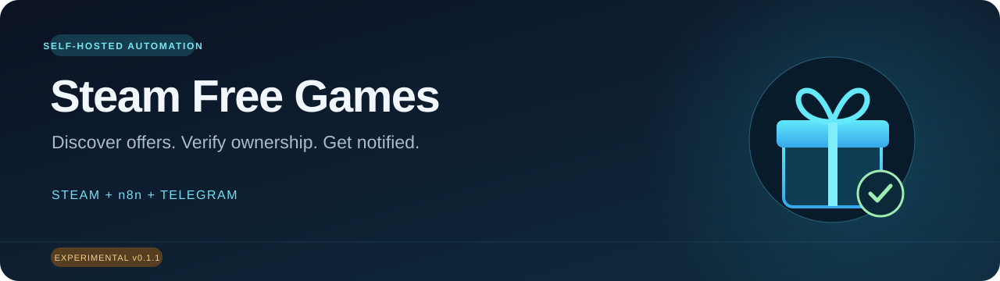

<p align="center"></p>

<p align="center">
  <a href="https://github.com/Ebnhussein/n8n-steam-free-games/actions/workflows/test.yml"></a>
  
  
  <a href="LICENSE"></a>
  
</p>

<p align="center"><a href="docs/SETUP.en.md"><strong>English setup guide</strong></a> · <a href="docs/SETUP.ar.md"><strong>دليل التشغيل بالعربي</strong></a> · <a href="docs/README.ar.md">نظرة عامة بالعربي</a></p>

# Steam Free Games for n8n

Discover Steam **free-to-keep games and DLC**, attempt eligible claims, and receive Telegram notifications with the game image, name, original price, and ownership status.

A small self-hosted helper handles Steam outside n8n. Import the workflow and configure your own credentials: **no SSH private key, custom n8n runner, or external Code-node modules**.

> **Experimental v0.1.0.** Automated tests cover the logic; a successful live license grant has not yet been confirmed for this portable release. Steam Store endpoints are undocumented and can change. See [validation status](docs/VALIDATION.md). Independent community project; not affiliated with Valve, Steam, or n8n.

## Start here

| I want to… | Open |
| --- | --- |
| Install and run everything step by step | [English setup](docs/SETUP.en.md) · [الشرح بالعربي](docs/SETUP.ar.md) |
| Create the helper and Telegram credentials | [English credentials](docs/SETUP.en.md#6-create-the-helper-credential-in-n8n) · [الكردنشلز بالعربي](docs/SETUP.ar.md#6-إنشاء-كردنشل-الربط-داخل-n8n) |
| Understand results or fix a problem | [Troubleshooting / حل المشاكل](docs/TROUBLESHOOTING.md) |
| Check what is actually verified | [Validation status](docs/VALIDATION.md) |
| Contribute or report a bug | [Contributing](CONTRIBUTING.md) · [Issues](https://github.com/Ebnhussein/n8n-steam-free-games/issues) |

## What it does

| Capability | Behavior |
| --- | --- |
| Giveaway discovery | Searches Steam Store's discounted-free results, including DLC, with pagination |
| Permanent ownership | Requires an explicit free-to-keep offer; excludes temporary free weekends |
| Base-game dependencies | Checks whether an unowned base is free; attempts that base before the DLC |
| Claim verification | Checks app or package ownership; a redirect alone is never success |
| Telegram notifications | Store image, title, pre-discount price/currency, status, reason, and link |
| Scheduled operation | Hourly workflow; unchanged notifications suppressed for seven days after successful scheduled runs |
| Safe first run | Workflow imports inactive, with dry-run enabled |
| Failure visibility | Separate error workflow for login, discovery, and other execution failures |

### What you configure

| Item | Where it goes | Why |
| --- | --- | --- |
| Steam login + Guard approval | Your own server terminal, once | Creates a local refresh token; password is not saved |
| Generated helper key | n8n **Header Auth**, header `X-API-Key` | Authenticates n8n to your helper |
| Telegram bot token | n8n **Telegram** credential | Sends messages through your own bot |
| Telegram chat ID | Telegram nodes in the imported workflows | Chooses where messages are delivered |

There is no official Steam n8n credential for this login/claim flow. A Steam Web API key alone is not a replacement. **Initial Docker setup and a one-time Steam sign-in are required**; later operation is scheduled, subject to token validity and Steam availability.

## Quick start

For an existing **self-hosted n8n** on the same Docker host. Docker Compose v2 and Git must already be installed. Use the full guide if any command or credential is unfamiliar.

```bash
git clone https://github.com/Ebnhussein/n8n-steam-free-games.git
cd n8n-steam-free-games
docker compose build
docker compose run --rm steam-helper node src/cli.cjs init
docker compose run --rm steam-helper node src/cli.cjs login
docker compose up -d
```

The `init` command prints your generated API key. Keep it private. Next:

1. Connect your n8n container to the helper's Docker network: [temporary and permanent setup](docs/SETUP.en.md#4-connect-n8n-to-the-helper).
2. Import [the main workflow](workflows/steam-free-games.json).
3. Configure **Header Auth**, your **Telegram** credential, and your chat ID.
4. Test with `{"dryRun":true}` and inspect **03 - Run Steam Helper**.
5. When ready, change the JSON body to `{"dryRun":false}`, then save and activate/publish.
6. Optionally import [the error workflow](workflows/steam-error-alert.json) and select it in the main workflow's settings.

The API is `http://steam-helper:3000/v1/run` **inside the private Docker network**. The provided Compose file does not publish a host port. Do not expose the helper publicly just to connect it to n8n Cloud.

## Understand the result

| Status | Meaning |
| --- | --- |
| `claimed` | Ownership was confirmed after the request |
| `already_owned` | Already in the account; no notification is sent |
| `eligible_dry_run` | Passed the relevant dry-run checks; nothing was added |
| `needs_review` | A prerequisite, ambiguous license, or another condition blocked the attempt |
| `verification_pending` | A request was made, but ownership is still unconfirmed |
| `error` | The individual attempt failed; the notification includes the reason |

**Free to Keep** means permanent ownership if an eligible claim succeeds. **Play For Free** usually means temporary access and is intentionally excluded. Permanently free games are only considered automatically when they are required as a base for a discovered DLC. Some require Steam-client activation, which is not implemented.

<details>
<summary><strong>Example notification layout</strong></summary>

The following is illustrative, not evidence of a successful live claim:

> 🎮 **Example Game**  
> 💰 Before: **the price/currency supplied by Steam**  
> ✅ Added to your library — only when ownership is confirmed  
> Steam product link

When Steam supplies an image, it is sent as a photo with the text as its caption. Otherwise, the text-only path is used. Missing original prices are labeled unavailable; they are never invented.

</details>

## Operating limits

- One account and one active run per helper instance; up to 20 claim attempts per run.
- Keep one helper instance per account/data volume to avoid token-renewal races.
- Discovery is best-effort. Regional availability, age gates, app-less bundles, search filtering, and Store markup changes can hide promotions.
- Prices use the Store response's currency, not a converted currency or a historical highest price.
- The project does not buy paid base games, bypass Steam Guard, or bypass region restrictions.
- A free base without an unambiguous Store license is reported for review.
- Steam login may need manual reauthentication. The code attempts refresh-token renewal daily.
- The portable Docker image and n8n workflow still need real-environment integration validation. The test suite does not prove successful Steam grants.

## Maintenance and development

```bash
# Read recent service logs
docker compose logs --tail=100 steam-helper

# Check Steam authentication without adding games
docker compose exec steam-helper node src/cli.cjs check

# Run local tests (Node.js 22+)
npm ci
npm test
```

See the setup guides for [updates, backups, and reauthentication](docs/SETUP.en.md#11-maintenance). `docker compose down` preserves the data volume; **`docker compose down -v` deletes saved credentials**.

## Project files

| Path | Purpose |
| --- | --- |
| `compose.yaml` / `Dockerfile` | Private helper service deployment |
| `src/` | Steam session, discovery, dependency checks, claims, and HTTP API |
| `workflows/` | Main n8n workflow and optional error notifications |
| `docs/` | English/Arabic setup, troubleshooting, and validation notes |
| `test/` | Offline parser, claim-order, ownership, and API tests |
| `.github/` | Automated tests, issue forms, and pull-request template |

## Contributing and license

Bug reports and anonymized compatibility fixtures are welcome. Please read [CONTRIBUTING.md](CONTRIBUTING.md) and [SECURITY.md](SECURITY.md). Do not upload tokens, cookies, passwords, Guard codes, SSH keys, or private execution exports.

[MIT License](LICENSE). Built with [steam-session](https://github.com/DoctorMcKay/node-steam-session). Steam and n8n names belong to their respective owners.
